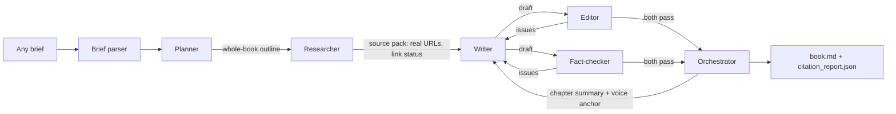

# Multi-agent book writer (any topic)

Give it a brief on any topic. Five agents plan, research, write, edit and fact-check a short book
with numbered citations and verified reference lists.

## Run
```bash
pip install -r requirements.txt
export OPENAI_API_KEY=sk-...                 # Windows PowerShell: $env:OPENAI_API_KEY="sk-..."

python main.py "A short book on how coffee farming is affected by climate change"
python main.py --file examples/upi_brief.txt          # the assignment's brief
python main.py                                        # prompts you to type/paste a brief
python main.py --file examples/upi_brief.txt --chapters 3 --min-words 600 --max-words 900 --rounds 3
```
The brief can be a full paragraph (title, audience, tone, chapters, length, source preferences) or just a
topic; missing details get sensible defaults. Command-line options override the parsed brief.
Output goes to `output/<book-title>/`: `book.md`, `citation_report.json`, `run_log.json`.

Optional: `MODEL=<model>` (default `gpt-4.1`, must support the Responses API `web_search` tool).
Anthropic also works: `LLM_PROVIDER=anthropic ANTHROPIC_API_KEY=... python main.py ...`.

## Architecture


## How agents communicate
Structured data passes through the orchestrator: brief -> outline -> source pack -> draft -> issue lists.
The Writer sees the whole-book outline and summaries of finished chapters, so chapters build on each other
without repeating, and chapter 1's opening is the voice anchor for the rest.

## Revision rounds and stopping
Per chapter: max rounds (default 3). Stop early when Editor and Fact-checker both pass. After the last round,
unverified sentences are deleted, the chapter is re-checked, and any leftover issue goes to `warnings`.
Work is bounded: 1 plan + chapters x rounds.

## Citation safeguards
- Sources come only from the search tool's structured citations (tracking params stripped); the model never types a URL.
- Links are checked at research time and again at verification; dead links dropped; bot-blocked sites flagged.
- The Fact-checker judges each cited sentence against the fetched page; uncited numbers/dates are rejected.
- References (publisher, title, URL) are built by code from the verified pack and renumbered per chapter.
- `citation_report.json` lists every source with link status and whether it is an official source.

## Tech
Python 3, OpenAI API (Chat Completions + Responses API `web_search`) or Anthropic API, requests, BeautifulSoup4, Mermaid.
